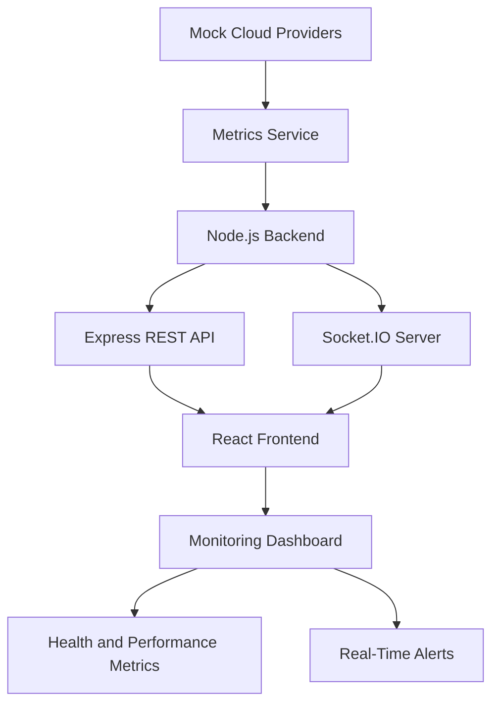

# CloudVista-360 | CloudPulse Monitor

<p align="center">
  <strong>Real-Time Multi-Cloud Infrastructure Monitoring Dashboard</strong>
</p>

<p align="center">
  
  
  
  
  
  
  
</p>

---

## 1. Project Overview

**CloudVista-360**, also known as **CloudPulse Monitor**, is a real-time multi-cloud infrastructure monitoring dashboard designed to provide a unified view of infrastructure health and performance.

The application simulates monitoring data across:

- Amazon Web Services (AWS)
- Microsoft Azure
- Google Cloud Platform (GCP)
- On-premise infrastructure

It provides a centralized dashboard to visualize infrastructure health, resource utilization, network performance and security-related alerts.

The backend generates simulated infrastructure metrics and streams real-time updates to the frontend using WebSockets.

**Note:** This project currently uses simulated monitoring data. It does not directly connect to live AWS, Azure or GCP accounts.

## 2. Key Features

### Multi-Cloud Monitoring
- Unified monitoring overview for AWS, Azure, GCP and on-premise environments.
- Aggregated infrastructure health score and uptime.
- Individual cloud provider health status.

### Real-Time Infrastructure Metrics
- CPU utilization.
- Memory utilization.
- Network latency and throughput.
- Resource uptime.
- Error rates.
- Security incident counts.

### Monitoring and Alerts
- Threshold-based infrastructure alerts.
- Healthy, warning and critical resource classifications.
- Alerts for high CPU utilization, degraded uptime, latency and repeated errors.
- Real-time metric updates through Socket.IO.

### Dashboard Interface
- Modern dark-themed monitoring dashboard.
- Responsive user interface.
- Provider status cards and KPI displays.
- Resource monitoring tables.
- Visual metric indicators.

## 3. Technology Stack

| Technology | Purpose |
|---|---|
| React.js | Frontend user interface |
| TypeScript | Type-safe development |
| Vite | Frontend development and build tool |
| Tailwind CSS | UI styling |
| Node.js | Backend runtime |
| Express.js | REST API |
| Socket.IO | Real-time communication |
| Mock Providers | Simulated cloud monitoring data |

## 4. System Architecture

The application follows a frontend-backend architecture with real-time communication.



### Architecture Workflow

1. Mock providers generate infrastructure metrics for different cloud environments.
2. The metrics service processes and updates resource information.
3. The Express backend serves API data.
4. Socket.IO streams updated metrics and alerts to connected clients.
5. The React dashboard visualizes the monitoring information.

## 5. Project Structure

```text
CloudVista-360/
│
├── backend/
│   ├── src/
│   │   ├── data/
│   │   │   └── mockProviders.ts
│   │   ├── services/
│   │   │   └── metricsService.ts
│   │   ├── config.ts
│   │   ├── index.ts
│   │   └── types.ts
│   ├── package.json
│   └── tsconfig.json
│
├── frontend/
│   ├── src/
│   │   ├── App.tsx
│   │   ├── main.tsx
│   │   ├── index.css
│   │   └── types.ts
│   ├── index.html
│   ├── package.json
│   ├── vite.config.ts
│   ├── tailwind.config.cjs
│   └── postcss.config.cjs
│
├── .gitignore
├── package.json
├── package-lock.json
└── README.md
```

## 6. Getting Started

Follow these instructions to run the project locally.

### Prerequisites

Make sure you have installed:

- Node.js 18 or above
- npm
- Git

### Step 1: Clone the Repository

```bash
git clone https://github.com/Chandanmn0724/CloudVista-360.git
```

```bash
cd CloudVista-360
```

### Step 2: Set Up the Backend

Open a terminal:

```bash
cd backend
npm install
```

### Step 3: Start the Backend Server

```bash
npm run dev
```

The backend runs by default at:

```text
http://localhost:4000
```

### Step 4: Set Up the Frontend

Open a second terminal from the project root:

```bash
cd frontend
npm install
```

### Step 5: Start the Frontend

```bash
npm run dev
```

The Vite development server usually runs at:

```text
http://localhost:5173
```

Open the frontend address in your browser to access the monitoring dashboard.

Keep both backend and frontend terminals running.

## 7. Configuration

The application supports environment-based configuration.

### Backend Environment Variables

| Variable | Description | Default |
|---|---|---|
| `PORT` | Backend server port | `4000` |
| `FRONTEND_ORIGIN` | Allowed frontend origin for CORS and WebSocket connections | `http://localhost:5173` |

These variables are optional.

### Frontend Environment Variables

Create a `.env` file inside the `frontend` directory if you need to override the backend connection settings.

```env
VITE_API_BASE_URL=http://localhost:4000/api
VITE_SOCKET_URL=http://localhost:4000
```

## 8. How the Monitoring Simulation Works

The application uses a simulated metrics engine to demonstrate infrastructure monitoring.

The workflow:

1. A collection of infrastructure resources is created across AWS, Azure, GCP and on-premise environments.
2. The backend periodically updates resource metrics with small random variations.
3. Metrics such as CPU, memory, latency, uptime and error rate are updated.
4. Threshold-based rules classify resources as healthy, warning or critical.
5. Alerts are generated when resource metrics cross configured thresholds.
6. Global and provider-level health scores are calculated.
7. Updated metrics and alerts are streamed to the frontend using Socket.IO.

This approach allows the monitoring dashboard to demonstrate real-time behavior without requiring cloud account credentials.

## 9. Extending the Project to Real Cloud Providers

The current implementation uses simulated data. It can be extended to integrate real infrastructure monitoring services.

Potential integrations include:

| Cloud / Platform | Monitoring Service |
|---|---|
| AWS | Amazon CloudWatch |
| Microsoft Azure | Azure Monitor |
| Google Cloud | Cloud Monitoring |
| On-premise | Prometheus and custom monitoring agents |

Possible improvements:

- Replace mock providers with actual cloud monitoring integrations.
- Map provider-specific metrics into a common resource data model.
- Store historical metrics in a database.
- Add historical performance charts.
- Implement user authentication and role-based access.
- Add configurable alert thresholds.
- Introduce centralized logging and monitoring.

## 10. Learning Outcomes

Through this project, I gained practical experience in:

- Building a full-stack application using React and Node.js.
- Developing backend services using Express and TypeScript.
- Implementing real-time communication using Socket.IO.
- Designing monitoring dashboards and metric visualizations.
- Understanding multi-cloud infrastructure monitoring concepts.
- Working with simulated infrastructure metrics and alert thresholds.
- Configuring frontend and backend development environments.

## 11. Future Enhancements

- Integrate real AWS, Azure and GCP monitoring APIs.
- Add persistent storage for historical infrastructure metrics.
- Implement authentication and role-based access control.
- Add advanced analytics and historical dashboards.
- Implement configurable alert notifications.
- Introduce containerization and CI/CD automation.

## 12. Author

**Chandan M N**

B.E. – Artificial Intelligence and Data Science

<p align="left">
  <a href="https://github.com/ChandanMN0724">
    
  </a>
  <a href="https://www.linkedin.com/in/chandanmn07">
    
  </a>
</p>

**Email:** [mnchandan605@gmail.com](mailto:mnchandan605@gmail.com)

---

<div align="center">
  <p><strong>Built with React, TypeScript, Node.js and Socket.IO.</strong></p>
  <p><em>Exploring real-time monitoring and cloud infrastructure.</em></p>
</div>
